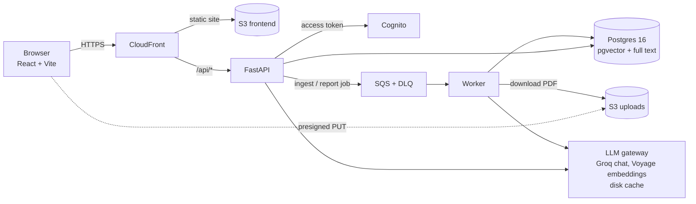
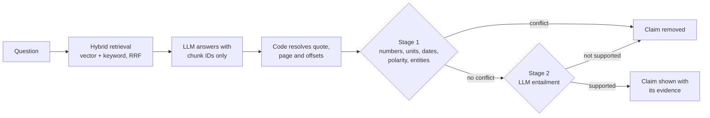

# CiteGuard

> A Verified-Citation Research Workspace with a Bounded Research Agent.

CiteGuard provides evidence receipts for every claim, enforces strict factual verification against source quotes, and abstains with *"The sources do not say"* whenever evidence is missing.

---

## Benchmark Results

All metrics are programmatically generated and reproduced via `make eval`. Hardcoded metrics are strictly forbidden.

<!-- RESULTS:START -->
_Last updated: 2026-11-11T06:15:05.769841+00:00 (golden questions: 25, verifier pairs: 91)_

> **Small sample.** 25 golden questions (target 50+) and 91 verifier pairs (target 175+). Treat these numbers as a smoke test, not as evidence.

### 1. Claim verifier (stage 1 deterministic checks, then LLM entailment)
| Metric | Value | Release target | Status |
| :--- | :--- | :--- | :--- |
| Precision | 1.0000 | >= 0.9500 | PASS |
| Recall | 0.9697 | >= 0.8500 | PASS |
| F1 | 0.9846 | - | - |
| False acceptance rate | 0.0000 | <= 0.0200 | PASS |
| False rejection rate | 0.0303 | - | - |
| Accuracy 95% CI (bootstrap) | [0.8352, 0.9560] | - | - |

Stage 1 alone (numbers, units, dates, polarity, entities; no LLM):

| Precision | Recall | False acceptance rate | False rejection rate |
| :--- | :--- | :--- | :--- |
| 0.5410 | 1.0000 | 0.4828 | 0.0000 |

### 2. Golden set category distribution
| Category | Count |
| :--- | :--- |
| factual | 5 |
| numerical | 6 |
| comparative | 3 |
| temporal | 2 |
| multi-hop | 2 |
| multi-document | 3 |
| conflicting | 1 |
| unanswerable | 3 |

### 3. Retrieval and grounding ablations
_Not measured yet. Put your PDFs in `data/corpus/`, configure an LLM provider, and run `make eval`._

### 4. Single-shot (E7) vs Report Agent (E8)
_Not measured yet. Put your PDFs in `data/corpus/`, configure an LLM provider, and run `make eval`._
<!-- RESULTS:END -->

---

## Architecture



How a question is answered:



Locally, LocalStack stands in for S3 and SQS and sign-in is a typed user id. On AWS the API, the worker and Postgres run with Docker Compose on one small EC2 instance; that deployment is written but not applied yet (see [Planned](#planned)).

## Known limitations
- **One EC2 instance.** The API, the worker and Postgres share it, so it is a single point of failure. A nightly `pg_dump` to S3 is the only backup.
- **HTTP between CloudFront and the instance.** Viewers always get HTTPS; the origin hop needs a domain and a certificate to be encrypted too.
- **No OCR.** A scanned PDF without a text layer is rejected, not read.
- **English only.** The stage 1 checks (number words, negation, direction) are English rules.
- **Groq and Voyage instead of Bedrock.** The AWS account has no Bedrock quota, so chat and embeddings go to external APIs.
- **Evaluation data is small and its labels are LLM-drafted.** They have not been reviewed by a person yet, so treat the numbers above as a smoke test.

---

## Quickstart

```bash
# 1. Postgres 16 + pgvector and LocalStack. If port 5432 is taken on your machine: POSTGRES_PORT=5434 make up
make up                       # also creates the S3 bucket, SQS queue and browser-upload CORS (infra/localstack/init.sh)
alembic upgrade head          # DATABASE_URL points at it (default: the compose database on 5432)

# 2. Tests. They use the real Postgres (set TEST_DATABASE_URL if you changed the port) and a fake LLM.
make test

# 3. Evaluation. The verifier part runs anywhere; retrieval/agent runs need your PDFs in data/corpus/
#    and a model: LLM_PROVIDER=bedrock (AWS credentials) or LLM_PROVIDER=groq with GROQ_API_KEY.
make eval
```

Run the services (set `AUTH_MODE=local` for development; it has no default, on purpose):

```bash
AUTH_MODE=local uvicorn services.api.main:app
S3_BUCKET=... SQS_QUEUE_URL=... python -m services.worker.main
```

### Environment variables
Copy `.env.example` to `.env`. Nothing is hardcoded; prod reads these from SSM.

| Variable | Used by | Notes |
| :--- | :--- | :--- |
| `AUTH_MODE` | API | Required, no default: `local` (trusts `X-User-Id`, dev only) or `cognito` |
| `DATABASE_URL` | API, worker, Alembic | Default: compose Postgres on 5432 |
| `TEST_DATABASE_URL` | tests | Server for the throwaway `citeguard_test` database |
| `S3_BUCKET`, `SQS_QUEUE_URL` | API, worker | Uploads and job queue |
| `AWS_REGION`, `AWS_ENDPOINT_URL_S3`, `AWS_ENDPOINT_URL_SQS` | boto3 | `http://localhost:4566` for LocalStack; per service so Bedrock still goes to AWS |
| `LLM_PROVIDER`, `GROQ_API_KEY`, `GROQ_MODEL` | gateway | Chat: `bedrock` or `groq` (default model `openai/gpt-oss-20b`). Unset: API returns 503 |
| `VOYAGE_API_KEY` | gateway | Embeddings via Voyage `voyage-3.5`; without it, Bedrock Titan (`LLM_PROVIDER=bedrock`). Switching provider means re-uploading sources |
| `CITEGUARD_SMALL_MODEL`, `CITEGUARD_LARGE_MODEL` | gateway | Optional model ID overrides |

---

## Architecture Principles
1. **Deterministic + Entailment Verification**: Numbers, dates, units, and polarity are strictly checked before LLM entailment. Rejected claims never reach the answer text.
2. **Multi-Tenant Isolation**: Every database access filters by `user_id` and `notebook_id`; a cross-user test runs against real Postgres.
3. **Bounded Agent State Machine**: A plain Python state machine. Every LLM call, including verification calls, counts against the step, retry and token budgets. The report is built from verified claims only.
4. **Zero-Vanity Metrics**: Every number in this file comes from `results/results.json`. With no LLM configured the gateway raises; it never invents an answer.

---

## Web UI (apps/web)

React + Vite + TypeScript, plain CSS. Needs the API running with `AUTH_MODE=local` (the sign-in screen sends the name you type as the user id).

```bash
make web         # http://localhost:5173, proxies /api to the API on :8000 (set API_URL to change it)
make web-build   # type-check, production build, Vitest unit tests
```

Notebook list, PDF upload with progress, chat with a status badge per claim, an evidence panel (quote, page, document, Open PDF), reports with a step trace, and tokens plus estimated LLM cost per answer and per report (list prices from `PRICE_PER_MTOK`; embeddings not counted). Checked with the production build and HTTP calls through the dev proxy; the full flow in a browser needs an LLM provider.

## Planned
See [AUDIT.md](AUDIT.md) for the design-versus-code table.
- Real cross-encoder reranker (E4) - needs the `sentence-transformers` dependency, not added yet
- Query-rewrite and parent-child ablations (E5, E6) - need multi-turn golden questions / parent-child chunks
- URL ingestion endpoint - needs an SSRF guard (block private and metadata addresses) before it is safe
- AWS deployment: the Terraform, production image and deploy workflow are written and pass `terraform validate`, but have not been applied to an AWS account yet. Steps and costs: [infra/terraform/README.md](infra/terraform/README.md)
- Web UI: Cognito sign-in is written (authorization code + PKCE, used when the build has `VITE_COGNITO_DOMAIN` and `VITE_COGNITO_CLIENT_ID`) but has not been run against a real user pool; end-to-end browser tests; PDF viewer with highlighting
